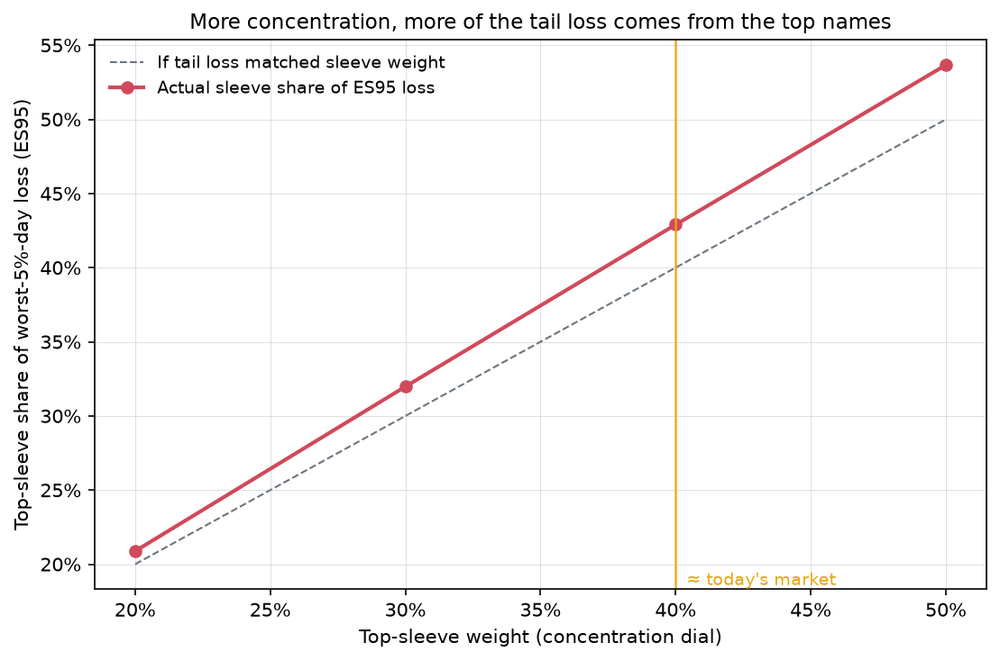
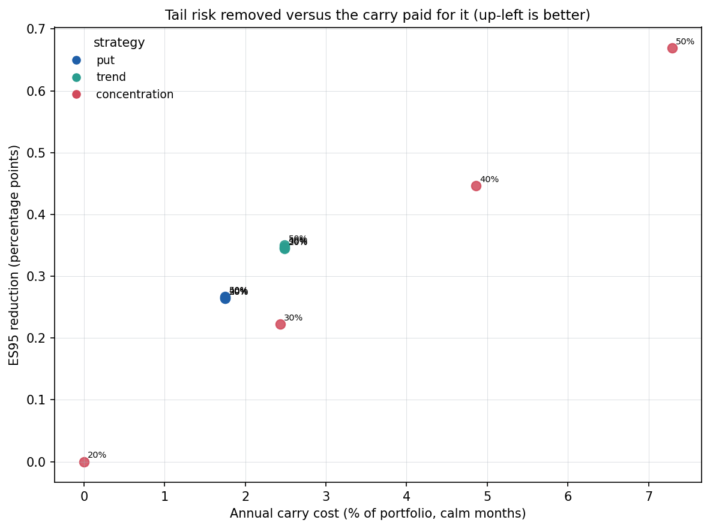

# When AI Stocks Are the Market: Managing AI-Driven Concentration Risk and Hedging Its Tail

**Concentration doesn't predict returns — but it reshapes the tail. This project measures
how, and tests which hedge protects a concentrated portfolio best after costs.**

The ten largest US stocks — mostly AI leaders — now carry roughly 40% of the S&P 500's
weight. The effective number of industries in the US market has fallen to about **10**,
the most concentrated since the 1930s (it ranged from 9.4 to 24 over 1926–2026). Prior
research says concentration does not predict future returns, so the advice is "do
nothing". This project asks a different question: does concentration change a portfolio's
**tail risk**, and at what point should a manager rebalance or hedge rather than sit still?

## Key findings

All numbers are computed in the notebook and written to `results/tables/`; nothing here is
hard-coded.

- **H1 — Concentration leaves returns alone but worsens the tail (supported).** Replicating
  Kritzman & Turkington on 49 industries (1926–2026), concentration does not predict future
  returns, volatility or drawdowns (all Newey–West |t| < 1.5, R² ≤ 0.02). Yet as the top-10
  weight rises from 20% to 50%, the top sleeve's share of the worst-5%-day loss (ES95) rises
  from **21% to 54%**, and the effective number of bets falls from **1.8 toward ~1.1** in
  broad crashes (2011, 2015, 2020).
- **H2 — Index hedges don't scale with concentration; the concentration hedge does
  (supported).** The put and trend overlays cost the same per dollar at every dial. Only the
  concentration hedge (short QQQ, sized by excess concentration × sleeve beta) grows with the
  dial, closing the protection gap exactly where it is needed.
- **H3 — The CVaR-optimal mix leans on the concentration hedge as concentration rises
  (supported).** Walk-forward, the average concentration-hedge weight goes **0.00 → 0.04 →
  0.11** from the 20% to the 40% dial. The CVaR mix cuts ES95 (−0.0273 → −0.0243), volatility
  (18.1% → 16.3%) and drawdown out of sample at the 40% dial.
- **H4 — The best choice depends on the dial and the crash you insure against (mixed).** By
  tail-risk removed per unit of carry, the monthly put and the cheap rebalancing rules win at
  every dial (~15 pp of ES reduction per unit of carry). The concentration hedge removes the
  most tail outright at high concentration (0.45 pp of ES95 at the 40% dial) but at a higher
  cost per point — so it pays only if you expect a concentration-driven crash.

## Headline figures



*As the dial turns up, the top names contribute more than their weight to the worst-day loss.*



*Tail risk removed against the carry paid for it; up and to the left is more efficient.*

## Motivation and research question

US equity indices are now dominated by a handful of mega-cap AI names. The standard reading
of the concentration literature — that concentration has no predictive power for returns — is
often taken to mean concentration is harmless. But risk is not return: a portfolio can have
the same expected return and a far uglier tail. This project builds a simple "concentration
dial" on real mega-cap data and asks **whether concentration changes tail risk even when it
does not change expected return, and which of doing nothing, rebalancing, or hedging gives the
best net return for the protection it buys at each concentration level.**

## Papers extended

| Paper | Original | What this project adds |
|---|---|---|
| Kritzman & Turkington (2025), *The Fallacy of Concentration* | Concentration does not predict returns/vol/drawdowns, 1926–2025 | Replicate a simplified version, then test **tail structure** instead of return prediction |
| Bacchetti (2026), *Different Maturities, Different Protection* | S&P 500 + put ladder + trend overlay, 2000–2024 | Apply puts + trend across concentration levels and add a **concentration-targeted hedge** |
| Noguer i Alonso & Al-Fallouji (2026), *Tail Risk Management with Puts and Trend Following* | CVaR-optimal mix of puts and trend (simulation) | Solve the CVaR mix on **real walk-forward data** with a third hedge channel |

Supporting methods: Rockafellar & Uryasev (2000) CVaR LP; Meucci (2009) effective number of
bets; Elkamhi, Lee & Salerno (2023) clustered inverse-vol weights; Chen (2025) 5% trimming
threshold; Cao & Conlon (2025) naive futures hedge.

## Data sources (all free, no paid data, no index-constituent history)

| Data | Source | Notes |
|---|---|---|
| 49 industry portfolios (monthly VW returns, firm counts, avg size) | Ken French Data Library | Industry cap = #firms × avg size; −99.99/−999 → NaN |
| Market & risk-free factors | Ken French `F-F_Research_Data_Factors` | Mkt = Mkt-RF + RF |
| Daily mega-cap prices (32 candidates) | yfinance, `auto_adjust=True` | Candidate pool in `config.py` |
| Shares outstanding (point-in-time) | SEC EDGAR XBRL companyfacts | `dei:EntityCommonStockSharesOutstanding`, falling back to us-gaap and weighted-average basic shares |
| Rest-of-market sleeve | RSP (equal-weight S&P 500) via yfinance | Contains the top-10 at ~2% (small contamination) |
| Index & hedge instruments | yfinance: SPY, ^SP500TR, QQQ, RSP | SPY/QQQ shorts proxy for index futures |
| VIX term structure & skew | yfinance (^VIX, ^VIX3M, ^VIX6M, ^VIX9D, ^SKEW); Cboe CSV fallback | ^VIX1Y unavailable → nearest tenor used |
| Put-protection benchmark | Cboe PPUT (Yahoo, Cboe CSV fallback) | Calibrates/validates modelled put costs |
| Risk-free rate | FRED DTB3 | Annual % → daily simple rate |

**Survivorship bias.** The stock analysis uses point-in-time shares outstanding from SEC
filings and ranks by market cap at each year-end, so the top sleeve is chosen only from
information available then. The candidate pool is still a set of *currently listed* names (no
delisted firms), which is a residual source of bias noted below. The fixed-AI-basket robustness
run is explicitly hindsight-selected and flagged as such.

## Methods summary

1. **Replication** — effective number of industries `1/Σwᵢ²`; Newey–West predictive regressions
   of future return/vol/drawdown on standardised concentration; a concentration-timing rule vs
   buy-and-hold.
2. **Concentration dial** — yearly top-10 ranking → cap-weighted sleeve blended with RSP at
   20/30/40/50% (40% ≈ today's market), monthly rebalanced; tail-share of ES95 and the Meucci
   effective number of bets, calm vs stress.
3. **Rebalancing rules** — 5% single-name cap, equal-weight sleeve, clustered inverse-vol
   (average-linkage on √(0.5(1−ρ)), inverse-vol within three clusters, equal risk budget across).
4. **Hedges** — monthly 5%-OTM put (Black–Scholes at σ = m·VIX/100, calibrated to PPUT with
   **m = 0.95**, out-of-sample monthly tracking error 1.1%), a 1/3/6/12-month put ladder, a
   200-day trend overlay, a permanent naive futures short, and the concentration hedge.
5. **CVaR mix** — Rockafellar–Uryasev LP minimising weekly CVaR95 over {put, trend,
   concentration}, estimated on trailing 5 years and applied walk-forward.
6. **Scorecard & policy** — net return, carry cost, cost per point of ES removed, average loss
   avoided, break-even crash probability, and the best strategy per dial.

### Methodology notes (simplifications and approximations)

- **Option pricing is VIX-based**, not from an option surface: σ = m·VIX/100 with a single
  calibrated scalar m, 5% bid-ask markup; the 12-month ladder leg uses ^VIX6M because ^VIX1Y is
  unavailable on Yahoo. The calibrated model tracks PPUT closely to ~2022 then drifts slightly.
- **SPY (auto-adjusted)** is used as the S&P underlying for both returns and option strikes; the
  dividend effect on 1-month strikes is small.
- **RSP contamination:** the rest-of-market sleeve holds the top-10 at ~2% total weight.
- **Multi-class share counts:** Alphabet/Meta totals come through combined/weighted-average
  share tags; Berkshire's EDGAR cover count is Class-A only, so BRK-B's cap is understated and it
  effectively never enters the top sleeve — a known limitation.
- **SPY/QQQ shorts proxy for index futures**; financing is the T-bill rate minus a 25 bp borrow
  spread, with 2 bp per unit of overlay turnover.
- **EDGAR XBRL coverage** is reliable only from ~2010, so the stock-level analysis runs 2010→latest.
- The candidate pool is **currently-listed names only** (no delisted firms).

## How to run

```bash
pip install -r requirements.txt
# set your SEC contact in src/config.py: SEC_USER_AGENT = "Your Name your.email@example.com"
jupyter nbconvert --to notebook --execute --inplace notebooks/ai_concentration_tail_hedging.ipynb
pytest -q
```

Raw downloads cache under `data/raw/` (git-ignored); re-running does not re-download unless
`force=True`. The full notebook runs in well under 10 minutes after data is cached.

### Repository structure

```
src/        config, data_loaders, replication, portfolio, concentration,
            rebalancing, options, hedges, cvar, metrics, scorecard, plots
notebooks/  ai_concentration_tail_hedging.ipynb
tests/      test_core.py
results/    figures/ (PNG, 150 dpi)   tables/ (CSV)
data/       raw/ (git-ignored)        processed/
```

## Limitations and possible extensions

- No delisted names — adding a survivorship-free price source would sharpen the ranking.
- Options priced off VIX, not a real surface; a listed-option dataset would improve the put legs.
- One static multiplier m for all tenors; a tenor-specific or time-varying calibration is natural.
- Monthly rebalancing and simple cost model; intraday/limit effects and realistic financing are out of scope.
- Extensions: a regime-switching dial, a volatility-targeted overlay, and a transaction-cost-aware CVaR objective.

## References

- Kritzman, M. & Turkington, D. (2025). *The Fallacy of Concentration.* SSRN 5436695.
- Bacchetti, A. (2026). *Different Maturities, Different Protection: Combining a Put Ladder with Trend Following to Hedge Equity Tail Risk.* SSRN 7541200.
- Noguer i Alonso, M. & Al-Fallouji, A. (2026). *Tail Risk Management with Puts and Trend Following: A CVaR Framework for Crashes and Drawdowns.* arXiv 2607.00883.
- Rockafellar, R.T. & Uryasev, S. (2000). *Optimization of Conditional Value-at-Risk.* Journal of Risk.
- Meucci, A. (2009). *Managing Diversification.* Risk.
- Elkamhi, R., Lee, J. & Salerno, M. (2023). Clustered risk-based allocation. *JFDS.*
- Chen (2025), *JFE*; Cao, C. & Conlon, T. (2025), *Journal of Futures Markets.*

---

**Author:** Kavin Dhanasekaran — MS Financial Engineering, NYU Tandon · [linkedin.com/in/kavnd](https://linkedin.com/in/kavnd)

*Disclaimer: research only, not investment advice.* Licensed under the MIT License.
